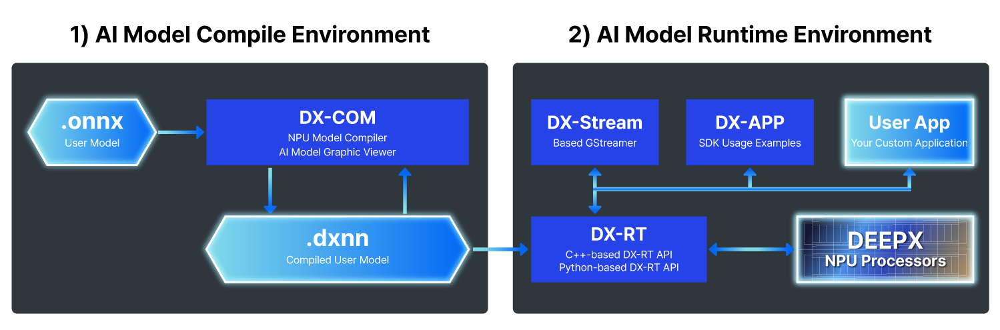

<div align="center">

# DX-Compiler

**Compile ONNX models into NPU-ready `.dxnn` binaries for DEEPX NPUs.**

[](https://github.com/DEEPX-AI/dx-compiler/releases)
[](https://developer.deepx.ai/tech-docs/DXNN-SDK/DX-COM/Quick_Start/)

</div>

<div align="center">
  <picture>
    <source media="(prefers-color-scheme: dark)" srcset="./source/img/dxnn_sdk_illustration_simple-dark.png">
    
  </picture>
</div>

DX-Compiler provides **DX-COM**, the compiler of the DXNN® SDK. It quantizes an ONNX model to INT8 and
compiles it into a `.dxnn` file that DX-RT runs on any DEEPX NPU. It is the host-side part of
[DX-AllSuite](https://github.com/DEEPX-AI/dx-all-suite), which keeps the compiler and runtime versions aligned.

- **CLI and Python API** — `dxcom` for single-input models, `dx_com.compile()` for multi-input models and automated pipelines.
- **Accuracy recovery with Q-Master** — quantization-aware training from the same config when post-training quantization is not enough.
- **Compilation Summary Report** — `--export_html` writes a self-contained HTML report of the compiled model.

## What You Need

| | |
|---|---|
| **Arch** | x86_64 only |
| **OS** | Ubuntu 20.04 / 22.04 / 24.04 / 26.04 LTS, Fedora 42–45, RHEL 9–10, CentOS Stream 9–10 |
| **Memory** | 16 GB RAM or more, 8 GB free disk |
| **Python** | 3.8–3.14 |
| **GPU** | Optional. A CUDA GPU speeds up quantization and is required for Q-Master |
| **DX-RT** | v3.5.0 or later to run `.dxnn` files from this release |

## Quick Start

Install DX-COM without cloning the repository (Ubuntu, needs `sudo`):

```bash
curl -fsSL https://raw.githubusercontent.com/DEEPX-AI/dx-compiler/main/oneline-install.sh | sh
dxcom --version
```

The installer creates a virtualenv at `~/deepx/venv-dx-compiler` and links `dxcom` into `~/.local/bin`.
The first install downloads several GB (`torch`, `onnxruntime`). On Fedora, RHEL or CentOS Stream, clone the
repository and run `./install.sh` instead (see [Compile the Sample Models](#compile-the-sample-models)).

Then compile a model:

```bash
dxcom -m model.onnx -c config.json -o output/      # → output/model.dxnn
```

The config describes the input shape, calibration images and preprocessing — see
[JSON File Configuration](https://developer.deepx.ai/tech-docs/DXNN-SDK/DX-COM/02_05_JSON_File_Configuration/).

### Compile the Sample Models

Clone the repository to get the sample models and calibration data:

```bash
git clone https://github.com/DEEPX-AI/dx-compiler.git
cd dx-compiler
./install.sh                                       # also downloads the sample models and calibration data
./example/3-compile_sample_models.sh               # → dx_com/output/*.dxnn
```

## Compile with Python

Activate the virtualenv that holds `dx_com` first (one-line install path shown; a clone install prints its own path):

```bash
source ~/deepx/venv-dx-compiler/bin/activate
```

```python
import dx_com
dx_com.compile(model="model.onnx", output_dir="output/", config="config.json")
```

Use the Python API for multi-input models (with a torch DataLoader) and automated pipelines →
[Execution of DX-COM](https://developer.deepx.ai/tech-docs/DXNN-SDK/DX-COM/02_06_Execution_of_DX-COM/)

<details>
<summary><b>One-Line Install Options, System-Wide Install, Uninstall</b></summary>

Options (environment variables):

- `DX_VERSION=X.Y.Z` — pin the `dx-com` release (default: newest on PyPI)
- `DX_INSTALL_DIR=<dir>` — install root (default: `~/deepx`, venv at `~/deepx/venv-dx-compiler`)
- `DX_BIN_DIR=<dir>` — where the `dxcom` launcher is linked (default: `~/.local/bin`)
- `DX_NO_UV=1` — install with pip instead of [uv](https://docs.astral.sh/uv/)
- `UV_PIN=X.Y.Z` — the uv release to bootstrap (pinned by default, so a run never pulls an unreviewed version)

Packages are installed with **uv**, which is much faster than pip for `torch` and the CUDA runtime. uv is
used if present, otherwise fetched as a standalone binary into `~/.local/bin` — never through `pip`, because
Debian and Ubuntu mark the system Python as externally managed (PEP 668). If uv cannot be obtained, the
installer falls back to pip; both install the same packages into the same venv.

The installer apt-installs `libgl1` and `libglib2.0-0`, which `opencv-python` (a `dx-com`
dependency) needs to import, so run it as root or with `sudo` available.

System-wide install on a shared machine:

```bash
curl -fsSL https://raw.githubusercontent.com/DEEPX-AI/dx-compiler/main/oneline-install.sh \
  | sudo DX_INSTALL_DIR=/opt/deepx DX_BIN_DIR=/usr/local/bin sh
```

Uninstall — pass the same `DX_INSTALL_DIR` / `DX_BIN_DIR` you installed with:

```bash
curl -fsSL https://raw.githubusercontent.com/DEEPX-AI/dx-compiler/main/oneline-uninstall.sh | sh
```

The uninstaller removes the `dxcom` launcher only while it still points into the venv being deleted, so
another install's `dxcom` is never touched. `uv` and the `libgl1` / `libglib2.0-0` packages are
left in place and listed at the end. In a clone, `./uninstall.sh` removes both one-line and clone-based installs.

</details>

<details>
<summary><b>Clone-Based Install Options (<code>install.sh</code>)</b></summary>

`install.sh` uses uv when it is available and pip otherwise. Pass `--uv=true` to install uv first if it is
missing, or `--uv=false` to force pip:

```bash
./install.sh --target=dx_com --uv=true
./install.sh --target=dx_com --uv=false
```

All options: `./install.sh --help`. Details → [Installation of DX-COM](https://developer.deepx.ai/tech-docs/DXNN-SDK/DX-COM/02_02_Installation_of_DX-COM/)

For Docker, see [Setting Up Environment](https://developer.deepx.ai/tech-docs/DX-AllSuite/Setting_Up_Environment/).

</details>

## Documentation & Support

- Guides, configuration and API reference: **[DX-COM Tech Docs](https://developer.deepx.ai/tech-docs/DXNN-SDK/DX-COM/Quick_Start/)** · [Release Notes](./RELEASE_NOTES.md)
- For technical questions, please ask in the DEEPX Developer Community: https://community.deepx.ai/c/support/5

## License

See [LICENSE](./LICENSE) for terms of use.

Copyright © DEEPX Co., Ltd.
